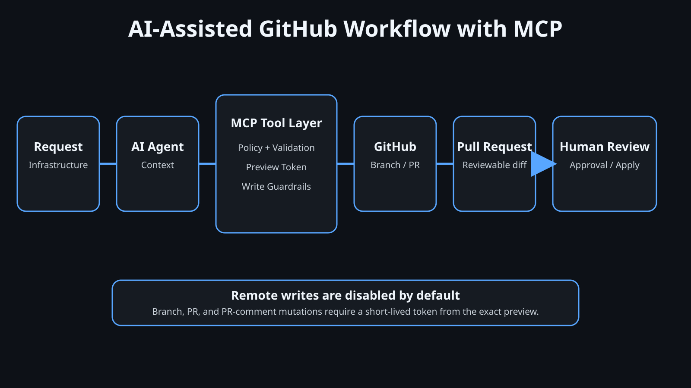

# GitHub Flow MCP

[Português (Brasil)](README.pt-BR.md)

A policy-aware Model Context Protocol server for GitHub and GitHub Actions workflows. It is designed for AI-assisted infrastructure work where agents can inspect repositories and prepare changes, while remote mutations remain constrained by explicit preview-bound approval.



## Why this exists

AI agents are useful at collecting context and preparing repetitive Git operations, but infrastructure workflows still need reviewability and guardrails. This MCP exposes a deliberately small GitHub surface:

- repository, branch, pull request, review, and Actions inspection
- local Git inspection without silent branch/commit/push/merge operations
- branch and pull-request previews
- short-lived, single-use confirmation tokens bound to the exact preview
- optional Basecamp linkage
- optional repository-specific label and reviewer policy
- no merge tool, no branch deletion, no branch-protection changes, and no API-created commits

## Safety model

Remote write tools are not registered unless:

```dotenv
GITHUB_WRITE_ENABLED=true
```

When enabled, branch creation, pull-request creation, and PR comments still require a `confirmation_id` returned by their matching preview. The token is short-lived, single-use, and bound to the exact payload. If a branch source SHA, PR body, label set, reviewer set, or comment changes, a new preview is required.

> [!NOTE]
> The MCP enforces preview-before-write and exact payload binding. The MCP host should only forward the `confirmation_id` after actual human approval.

## Installation

```bash
uv tool install git+https://github.com/thiagorchaves/github-flow-mcp.git
```

For development:

```bash
git clone https://github.com/thiagorchaves/github-flow-mcp.git
cd github-flow-mcp
uv sync --extra dev
```

## Configuration

```bash
cp .env.example .env
chmod 600 .env
```

Use a fine-grained GitHub token with the minimum repositories and permissions needed. Typical permissions are Metadata read, Contents read/write for branch creation, Pull requests read/write, Issues read/write for labels/comments, Actions read, and Members read only when reviewer availability checks are required.

Organization-specific policy belongs in your local `.env`, not in the public repository. For example, you can require Basecamp links, configure a production branch marker, or require an AI-review label for selected repositories.

## Kiro / MCP host example

```json
{
  "mcpServers": {
    "github-flow": {
      "command": "uvx",
      "args": ["--from", "git+https://github.com/thiagorchaves/github-flow-mcp.git", "github-flow-mcp"],
      "env": {
        "GITHUB_TOKEN": "${GITHUB_TOKEN}",
        "GITHUB_DEFAULT_OWNER": "${GITHUB_DEFAULT_OWNER}",
        "GITHUB_INITIALS": "tc",
        "GITHUB_DEFAULT_BASE_BRANCH": "main",
        "GITHUB_LOCAL_REPOS_ROOT": "${HOME}/Projects",
        "GITHUB_WRITE_ENABLED": "false",
        "GITHUB_CONFIRMATION_TTL_SECONDS": "300"
      },
      "autoApprove": []
    }
  }
}
```

## Tools

### Read and diagnostics

- `healthcheck`
- `get_authenticated_user`
- `get_repository`
- `list_branches`
- `get_collaborator_permission`
- `inspect_local_repository`
- `list_pull_requests`
- `get_pull_request`
- `list_pull_request_files`
- `list_pull_request_reviews`
- `list_workflows`
- `list_workflow_runs`

### Preview

- `preview_branch_name`
- `preview_local_commit`
- `preview_remote_branch`
- `preview_pull_request`
- `preview_pull_request_comment`

### Remote writes, registered only when enabled

- `create_remote_branch`
- `create_pull_request`
- `add_pull_request_comment`

### Basecamp handoff

- `build_basecamp_pr_update`

This tool only generates Markdown. A Basecamp MCP can independently preview and publish that update.

## Recommended workflow

1. Retrieve the work-item context.
2. Inspect the local repository without modifying it.
3. Preview the branch and show it to the user.
4. After approval, use the preview token to create the remote branch if needed.
5. Edit and commit locally using your normal signed Git workflow.
6. Push the branch.
7. Preview the pull request.
8. After approval, use its token to open the PR.
9. Let humans review the PR and apply the infrastructure change through the normal delivery process.

## Development

```bash
uv sync --extra dev
uv run ruff format --check .
uv run ruff check .
uv run mypy github_flow_mcp
uv run pytest
```

## Security

Never commit `.env`, GitHub tokens, internal repository data, company-specific paths, or private work-item URLs. See [SECURITY.md](SECURITY.md).

## License

MIT. See [LICENSE](LICENSE).
